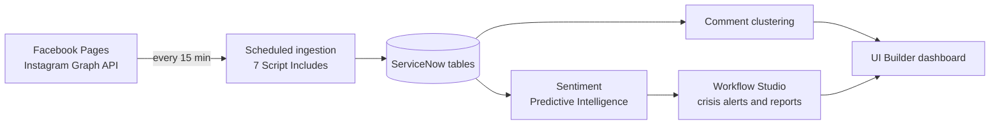
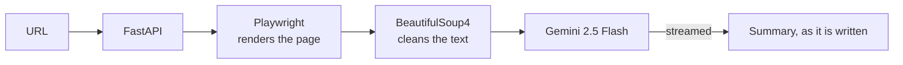

<!--
  SETUP
  1. Push this repo (it must be named exactly like your GitHub username), then run the "Profile cards"
     workflow once from the Actions tab. It fills in the live GitHub cards and the snake.
  2. Private contributions: create a personal access token with the read:user scope, save it as a repo
     secret named PROFILE_TOKEN, and tick "Include private contributions on my profile" in your GitHub
     profile settings. Without this the cards only see public activity and look smaller than your profile.
-->

<div align="center">



<br /><br />

<a href="https://www.linkedin.com/in/aadityamittal01"></a>&nbsp;&nbsp;
<a href="mailto:aaditya.mittal111@gmail.com"></a>

<br /><br />

<a href="https://codolio.com/profile/Aaditya%20Mittal"></a>

<br /><br />

[About](#about-me) &nbsp;|&nbsp; [Top project](#top-project) &nbsp;|&nbsp; [More work](#more-work) &nbsp;|&nbsp; [Tech stack](#tech-stack) &nbsp;|&nbsp; [Experience](#experience) &nbsp;|&nbsp; [Stats](#stats) &nbsp;|&nbsp; [Connect](#connect-with-me)

</div>

<br />

> [!NOTE]
> Open to **Software Engineer**, **Backend Engineer**, **AI Engineer** and **ML Engineer** roles. Feel free to connect.

<br />



<br />

## About me

I wrote my first program in 9th standard. It was meant to print the Fibonacci series. The computer disagreed with my ideas, so I changed something, ran it again, changed something else, ran it again.

That loop never left. I am an Analyst at Deloitte USI, where I build backend integrations and APIs on ServiceNow. Most of it is getting systems that don't always agree to agree, and I like it for exactly that reason. I am moving toward AI and software engineering, with ServiceNow as the entry point and not the destination.

**Education:** B.Tech in Computer Science (AI & ML), JECRC University, CGPA 9.49
<br />
**Certified:** ServiceNow CSA, CAD, CIS-DF, CIS-ITSM, plus NVIDIA AI for Anomaly Detection
<br />
**Outside code:** I taught myself chess from a rulebook and a Kasparov book, and I still play every day.

```js
const aaditya = {
  role: "Analyst, Deloitte USI",
  focus: "backend integrations & APIs",
  platform: "ServiceNow",
  languages: ["Python", "C++", "JavaScript"],
  building: ["FastAPI services", "LLM apps"],
  motto: 'I stop at "I understand why", not at "it works".',
};

while (!solved) {
    try_again();
}
```

<br />

## Top project

### Social Media Engagement Tracker

My hackathon-winning ServiceNow app, and the project that led to my Deloitte internship. It pulls Facebook and Instagram data every 15 minutes, scores the sentiment of what people say, clusters their comments, and raises an alert the moment a PR crisis starts to build. Weekly and monthly reports go out on their own.

I decided the whole build and wrote the ingestion layer, tuned to API limits so it scales to 10,000+ interactions per account per day. It won **All India Rank 1** at the ServiceNow x Deloitte HackNow, among 260+ teams.




<br />

## More work

<table>
  <tr>
    <td width="33%" valign="top">
      <h3>AI Website Summarizer</h3>
      <p>Paste a URL and watch the summary stream in as it is written. Playwright renders the page, so JavaScript-heavy sites work too. Gemini 2.5 Flash does the reading.</p>
      <p>
        
        
        
      </p>
    </td>
    <td width="33%" valign="top">
      <h3>Anime Face Generator</h3>
      <p>A DCGAN trained from scratch on 10,000 anime faces for 1,000 epochs. Co-authored the paper presented at I-LIPS 2025.</p>
      <p>
        
        
      </p>
    </td>
    <td width="33%" valign="top">
      <h3>IAESTE chapter website</h3>
      <p>The chapter site was broken, so I proposed a plan and rebuilt it in React and Tailwind CSS. It now scores 91 on SEO.</p>
      <p>
        
        
      </p>
    </td>
  </tr>
</table>

<details>
<summary><b>Under the hood: AI Website Summarizer</b></summary>

<br />



</details>

<br />

## Tech stack

<div align="center">
<br /><br />

<p><b>Languages</b></p>

<br /><br />

<p><b>Backend and data</b></p>

<br /><br />

<p><b>AI and frontend</b></p>

<br /><br />

<p><b>Tools</b></p>

<br /><br />

<p><b>Platform</b></p>


</div>

<br />

## Experience

| When | What | Highlights |
| :-- | :-- | :-- |
| Jul 2026 to now | **Analyst**, Deloitte USI (ServiceNow) | Own and extend backend integrations end to end: design docs, build, testing, UAT and handover. Took over integrations from other developers through knowledge transfer. |
| Before full time | **Intern**, Deloitte USI (ServiceNow) | Built 6 integrations and the automation behind 500K+ tickets a year. Converted to full time. |
| 2025 | **Remote research intern**, Iran University of Science and Technology (IAESTE) | Evaluated bot-detection models (BotRGCN, BotHunter) on Twitter profiles, in a team of five across three countries. |
| 2023 to 2025 | **IAESTE LC JECRC**, Head of IT-DA and Deputy Head, Incoming | Rebuilt the chapter website. Digitized intern onboarding and cut the time per intern by about 25 to 30 percent. |
| 2023 to 2024 | **GDSC JECRC**, AI & ML core team | Anchored an orientation of about 200 people and taught Python to 25+ juniors. |

<br />

## Stats

<div align="center">




<br /><br />


<br /><br />

<picture>
  <source media="(prefers-color-scheme: dark)" srcset="assets/github-snake-dark.svg" />
  
</picture>

</div>


<br />

## Connect with me

<div align="center">

### Recruiter or engineer with a hard problem? Feel free to connect.

<a href="https://www.linkedin.com/in/aadityamittal01"></a>&nbsp;&nbsp;
<a href="mailto:aaditya.mittal111@gmail.com"></a>

<sub>aaditya.mittal111@gmail.com</sub>

</div>
